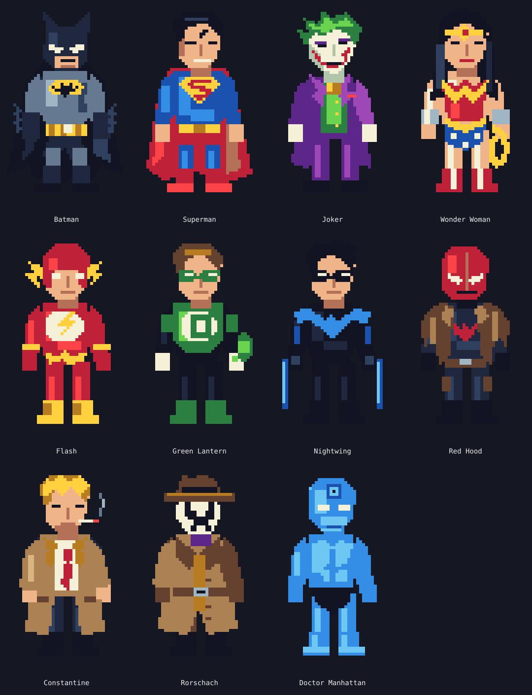
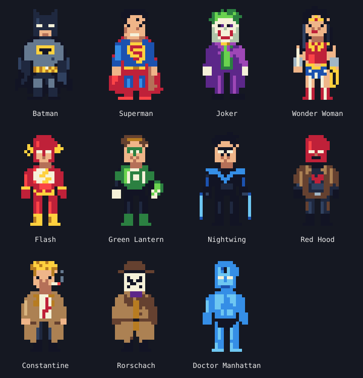

# DC Colorscripts

Original DC-inspired pixel art for Linux terminals, inspired by
[pokemon-colorscripts](https://github.com/nukeop/pokemon-colorscripts).
Display ten heroes and antiheroes, or Joker, with optional English or Russian phrases.
Python 3.11+, zero runtime dependencies, fully offline operation.



The preview shows the actual sprite pixels at 6× scale. Sprites are original,
programmatically drawn fan art, not downloaded images. All phrases are original
character-inspired writing, explicitly labeled rather than presented as canonical
dialogue.

## Installation

### Single-file installation on Fedora / Nobara

Build the compressed executable using only Python (no pip or build dependencies):

```sh
python3 tools/build_zipapp.py
./dist/dc-colorscripts --name batman
install -Dm755 dist/dc-colorscripts "$HOME/.local/bin/dc-colorscripts"
dc-colorscripts --random --lang en
```

The resulting `dist/dc-colorscripts` is one executable ZIP archive containing the
code, sprites, quotes, and license. Copy just that file to another Linux machine
with Python 3.11+ on `PATH`. It is a Python zipapp, not a native binary: Python
is not embedded. No virtual environment, pip, root, extraction, or runtime download
is needed. A SHA-256 file is generated alongside it; verify a downloaded artifact
with `sha256sum -c dc-colorscripts.sha256` from its directory.

CI uploads a `dc-colorscripts-single-file` artifact containing the executable and
checksum. After downloading and unpacking that CI artifact, install it with:

```sh
install -Dm755 dc-colorscripts "$HOME/.local/bin/dc-colorscripts"
```

Ensure `~/.local/bin` is on `PATH`. Remove this installation with
`rm "$HOME/.local/bin/dc-colorscripts"`. Use one installation method at a time to
avoid overwriting a pipx-managed entry point. The single-file build does not
modify your shell configuration or Conda environment.

### pipx / pip

From a checkout, without root:

```sh
pipx install .
# Alternatively, if your Python installation permits user-site packages:
python3 -m pip install --user .
```

After publication, install directly from GitHub:

```sh
pipx install git+https://github.com/najanaja89/dc-colorscripts.git
```

Ensure `~/.local/bin` is on `PATH`. Use pipx or a virtual environment on systems
with externally managed Python. Installation may fetch build tooling; execution
never accesses the network. Uninstall with `pipx uninstall dc-colorscripts` or
`python3 -m pip uninstall dc-colorscripts`, matching your installation method.

## Updating

Use the same installation method you originally chose. Run checkout-based commands
from the repository directory; `git pull --ff-only` fetches the latest changes
without creating a merge commit. Keep local edits committed or stashed first.

### Single-file installation

Pull the latest source, rebuild, and replace the installed executable:

```sh
git pull --ff-only
python3 tools/build_zipapp.py
install -Dm755 dist/dc-colorscripts "$HOME/.local/bin/dc-colorscripts"
dc-colorscripts --name batman --scale 0.5
```

If using a downloaded CI artifact instead, download and unpack the latest
`dc-colorscripts-single-file` artifact, then run from its extracted directory:

```sh
sha256sum -c dc-colorscripts.sha256
install -Dm755 dc-colorscripts "$HOME/.local/bin/dc-colorscripts"
```

### pipx / pip

For a pipx installation from a local checkout, reinstall the updated source.
`--force` also replaces an installation when the version number has not changed:

```sh
git pull --ff-only
pipx install --force .
```

For a pipx installation directly from GitHub:

```sh
pipx install --force git+https://github.com/najanaja89/dc-colorscripts.git
```

For a user-site pip installation from a checkout:

```sh
git pull --ff-only
python3 -m pip install --user --upgrade --force-reinstall .
```

For a virtual environment, activate it and use the same pip command without
`--user`. Shell startup settings do not need to change after an update.
Run `command -v dc-colorscripts` to check which executable your shell is using,
and `dc-colorscripts --help` to confirm newly added options are available.

## Usage

```sh
dc-colorscripts                         # random released character + phrase
dc-colorscripts --random
dc-colorscripts --name batman --no-quote
dc-colorscripts --name superman --lang ru
dc-colorscripts --name joker
dc-colorscripts --name batman --scale 0.5  # half width and height
dc-colorscripts --random --scale 0.75      # three-quarter size
dc-colorscripts --heroes --lang en
dc-colorscripts --villains --lang ru
dc-colorscripts --list
dc-colorscripts --quote-only
dc-colorscripts --version
dc-colorscripts --help
```

Identifiers are case insensitive. Unknown or unreleased characters and invalid
combinations return exit status 2 with an explanation. Category filters combine
with names and language options. Random selection excludes unfinished characters.
`--list` shows released and planned characters and honors category filters.

## Terminal rendering

Use a UTF-8 locale and a font supporting `▀`, `▄`, and `█`. Intended terminals
include Konsole, Kitty, Alacritty, and GNOME Terminal. Auto mode selects true color
for `COLORTERM=truecolor` or `24bit`, 256 colors for `TERM=*256color*`, and otherwise
16 colors. `NO_COLOR`, `TERM=dumb`, and redirected output disable ANSI in auto
mode. Override detection with `--color truecolor`, `--color 256`, `--color 16`, or
`--color none`. Explicit color also enables saving ANSI previews:

```sh
dc-colorscripts --name batman --no-quote --color truecolor > batman.ansi
cat batman.ansi
```

The 40×64 pixel sprites occupy 40 columns and 32 rows. Use `--scale 0.5` for half width and height (20 columns × 16 rows), or
`--scale 2` for double size when the terminal is wide enough. The default is `1`;
accepted factors are greater than 0 and at most 4. Nearest-neighbor sampling
preserves pixel edges and proportions, fitting the terminal width automatically.
At half size, bundled characters use detail-adjusted 20×32 pixel variants with
retouched eyes, faces, and chest emblems instead of simply dropping every other
pixel. These compact variants also apply when terminal width requires 20 columns
or fewer. Other sizes use nearest-neighbor sampling; very small sizes still lose
detail.


Quotes wrap to the current width, leaving one column to avoid automatic wrapping.
Width is detected on each invocation; existing output remains static on resize.
Transparent pixels use the terminal background. Colored cells reset their state,
and output ends in a newline. No cursor movement, terminal mode changes, animation,
or external image viewer is involved. Monochrome output retains the silhouette.

## Zsh integration

Add to `.zshrc`, independently of Starship and Zinit initialization:

```zsh
if [[ -o interactive ]] && command -v dc-colorscripts >/dev/null 2>&1; then
    dc-colorscripts --random --lang en --scale 0.5
fi
```

The application does not alter prompts or shell configuration. Interactive SSH
sessions work normally; to skip them, add `[[ -z ${SSH_CONNECTION:-} ]]` to the
condition. Non-interactive shells should not source this startup block. Direct
CLI execution also works in scripts and pipes.

## Characters

**Released heroes and antiheroes:**

| Character | CLI identifier |
| --- | --- |
| Batman | `batman` |
| Superman | `superman` |
| Wonder Woman | `wonder-woman` |
| The Flash (Barry Allen) | `flash` |
| Green Lantern (Hal Jordan) | `green-lantern` |
| Nightwing | `nightwing` |
| Red Hood | `red-hood` |
| John Constantine | `constantine` |
| Rorschach | `rorschach` |
| Doctor Manhattan | `doctor-manhattan` |

**Released villain:** Joker (`joker`). All 11 released characters have original
40×64 pixel sprites, detail-adjusted 20×32 compact variants, and three original
phrases in each language (English and Russian).

```sh
dc-colorscripts --name wonder-woman --scale 0.5
dc-colorscripts --name green-lantern --lang ru
dc-colorscripts --name constantine --quote-only
dc-colorscripts --heroes --random --scale 0.5
```

**Planned villains:** Harley Quinn, Darkseid, Deathstroke, Reverse-Flash, Lex Luthor,
Bane, Brainiac, Sinestro, Doomsday.

Planned records deliberately have no sprite, palette, or quotes yet and cannot be
selected. Artwork quality takes priority over expanding the roster.

## Architecture

- `src/dc_colorscripts/cli.py`: argument parsing and output orchestration.
- `characters.py`, `assets/characters.json`: data-driven character selection.
- `renderer.py`: independent palette-to-half-block renderer and color reduction.
- `quotes.py`, `assets/quotes/`: localized offline phrases and word wrapping.
- `assets/sprites/`: palette JSON and precompiled ANSI variants.
- `tools/`: original artwork generator and startup benchmark.
- `tests/`: pytest tests; `docs/`: previews and measurement notes.
- `.github/workflows/ci.yml`: Python 3.11–3.14 testing and wheel verification.

True-color ANSI preserves palette fidelity. Unicode half blocks combine two
vertical pixels per terminal cell. Precompiled ANSI eliminates per-pixel rendering
at normal widths; palette JSON is still loaded and validated, and supplies narrow
and monochrome rendering. PNG conversion would require extra development tooling
without a runtime advantage here. Normal execution needs no image processing,
subprocesses, or network access.

## Development

```sh
python3 -m venv .venv
. .venv/bin/activate
python -m pip install -e '.[dev]'
python tools/build_assets.py
python -m pytest
ruff check .
ruff format --check .
python -m build
python tools/benchmark.py
```

See [CONTRIBUTING.md](CONTRIBUTING.md) for adding sprites and translations.
CI installs the package, runs tests and Ruff, builds distributions, and smoke-tests
the wheel in a fresh virtual environment.

## Performance

The benchmark includes interpreter startup, asset loading, rendering/output
generation, and process exit with stdout sent to `/dev/null`. It forces true color
for Batman with a quote, discards five warmup runs, then measures 100 launches.
It excludes terminal painting. The target is under 100 ms with warm filesystem
caches. See [measured results](docs/performance.md) and reproduce locally with
`python tools/benchmark.py`; workstation and terminal timings may differ.

## License and attribution

Code, original artwork sources, generated assets, and original phrases use the
[MIT License](LICENSE), to the extent of contributors’ rights. DC character names,
designs, and related intellectual property belong to their respective owners.
This independent fan project is not affiliated with or endorsed by DC Comics or
Warner Bros. The license grants no rights to underlying characters or trademarks.
No canonical quotations or downloaded DC artwork are included.
